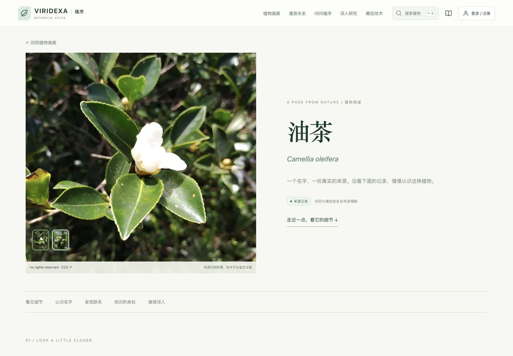
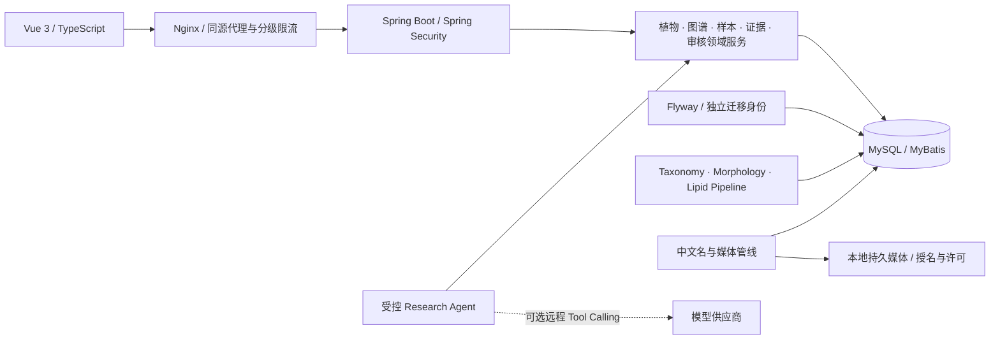

# VIRIDEXA · 植序

**面向植物知识探索与科研数据分析的现代 Java Web 平台。**

每一片叶子，都藏着一个世界。从中文名称和真实植物影像出发，沿着知识图谱走向独立研究样本、来源证据与科研分析。




## v0.1.0 的真实状态

| 本地数据库口径 | 2026-10-28 验收 |
| --- | ---: |
| 植物目录记录 / 可公开记录 | 60,031 / 60,028 |
| 有可追溯中文名称的目录记录 | 23,704（39.49%） |
| SP2000 2022 精确接受种匹配 | 23,670 |
| 有授权主图的目录记录 | 19 |
| 持久化 iNaturalist 照片 | 21，覆盖17条目录记录 |
| 公开结构化来源记录 | 94,798 |
| 正式人工核验科学事实 | **0** |
| 自动化测试 | 341 通过；生产只读检查另计20项 |

这些是**目录记录**，不能当作去重并核验后的独立物种数量。公开展示与科学可信度分别管理：资料记载、机器提取和具名人工核验始终分开。7,068个科研样本仍未确定关联物种；不会强行合并。当前没有真实模型 Key，Agent 使用真实领域服务检索降级模式；没有完成真实 LLM 联调。

完整边界、截图、排除原因与验收见 [发布记录](docs/VIRIDEXA_V0.1.0_RELEASE.md)。本仓库不附带完整本地数据库或科研数据。

## 探索与研究

- **数字植物馆**：沉浸首页、中文名/学名/已有别名搜索、植物画廊、真实影像相册、来源特征与名称出处。
- **Knowledge Graph Explorer**：Cytoscape.js 按需展开真实分类、名称、来源、样本和观测关系；提供文本替代视图。
- **Scientific Workbench**：ECharts 独立样本分析、单位与计量基础可比性检查、证据联动；缺失值保持缺失。
- **问问植序**：六个受控只读工具、工具执行轨迹、可引用记录、限时/并发/配额；支持可选远程模型供应商。
- **Evidence Lineage**：原始文件哈希、版本、记录定位、标准化与审核历史。
- **科研审核工作台**：真实身份、权限、并发冲突、事务审核、发布与撤回；不会自动批准来源候选。
- **幕后技术**：真实数据管线、架构、测试和安全状态，适合课程答辩。

公开目录和基础图谱可匿名浏览。Agent、实验台需要公众账户登录；审核写入需要管理员身份。没有预置公众或管理员密码。

## 技术栈与架构

Java 21、Spring Boot 4.1.2、Spring Security、MyBatis、Flyway、MySQL 8.0.44；Vue 3.5.44、TypeScript 5.9、Vite 8.3.5、Pinia、Vue Router、ECharts 6.1.0、Cytoscape.js 3.34.4；Docker Compose、Nginx。



[详细架构](docs/ARCHITECTURE.md) · [数据库设计](docs/DATABASE_VIRIDEXA_DESIGN.md)

## 名称、图片与科研来源

- **中文名**：用户提供的《中国生物物种名录2022》结构化文件，限定植物界、种级、接受名、明确中文名和精确学名；iFlora COLChina API 补充名称。保留原名称、来源版本、分类标识、工作表行号、SHA-256和匹配方法。无法匹配不翻译、不继承属名、不猜近似名称。
- **图片**：持久化原图及WebP派生图；严格匹配物种，逐张检查CC0/CC BY许可、来源和署名。另保留3张有出处的Commons公有领域/CC0图鉴素材。未找到合适图片时显示无图占位。
- **科研管线**：实际使用WFO目标切片、NHM、GBIF、Flora of China、USDA FDC、课程提取资料及研究论文。已下载不等于已全量导入；含油率、FAME、油脂组成、食品营养含量分开建模。

[数据来源及边界](docs/DATA_SOURCES.md) · [媒体许可与署名](docs/MEDIA_ATTRIBUTION.md) · [图鉴素材出处](docs/UI_ASSET_PROVENANCE.md)

**代码公开不等于科研原始数据也被授权公开。** 原始论文、未知许可图片、结构化名录整包和数据库快照不在本仓库分发。源码尚未选择许可证；没有自动添加LICENSE，各第三方资产遵守其独立许可。

## 本地启动

需要Docker Compose、Java 21、Node 22.12–22.x、Python 3与OpenSSL。详细流程见 [QUICK_START](docs/QUICK_START.md)。

```sh
./scripts/dev-env.sh
(cd apps/web && npm ci && npm run build)
./apps/api/mvnw -f apps/api/pom.xml -s .mvn/settings.xml package
docker compose up -d --build
python3 scripts/pipeline/provision_public_accounts.py
python3 scripts/pipeline/provision_governance.py
docker compose up -d --no-deps --force-recreate api
```

访问 <http://localhost:5173>。`dev-env.sh`安全生成本地数据库凭据并保存到忽略的0600 `.env`；[.env.example](.env.example)只含占位值。Flyway V1–V25负责新库结构，不要执行历史SQL快照代替迁移。业务只读、账户、审核、迁移和导入分别授权。

**干净克隆默认是空数据库**，支持启动和空状态；不会自动包含本地60,028条公开目录。需要完整数据时，按合法获取条件放入忽略的`data/raw/`并参照 [数据布局](docs/DATA_LAYOUT.md)、[导入说明](docs/IMPORT_PIPELINE.md)执行。不要向空库执行本机生产快照，不要对数据目录使用`git clean`。

名称与媒体工具默认dry-run；应用必须显式选择：

```sh
python3 -m pip install -r requirements-pipeline.txt
python3 scripts/pipeline/import_sp2000_names.py "data/raw/sp2000/your-2022-export.xlsx"
python3 scripts/pipeline/import_sp2000_names.py "data/raw/sp2000/your-2022-export.xlsx" --apply
python3 scripts/pipeline/import_botanical_media.py
python3 scripts/pipeline/audit_botanical_completeness.py
```

导入前由本地DBA执行`provision_botanical_importer.py`授予追加名称/媒体权限；它不授予科学审核或账户操作权限。图片采集命令、幂等性及本地存储说明见媒体文档。R2/OSS不是运行前提，目前尚未实现对象存储适配器。

## 安全与测试

Spring Security/RBAC、CSRF、同源Session、服务端资源权限、参数及分页上限、受控Agent、账户/IP防爆破、Turnstile适配、Nginx分级限流和可信代理配置均有测试覆盖。Cloudflare真实凭据、HTTPS和公网拓扑仍需部署者配置；不声称能完全阻止DDoS。

```sh
./apps/api/mvnw -f apps/api/pom.xml -s .mvn/settings.xml test
(cd apps/web && npm test && npm run build)
python3 -m unittest discover -s tests
python3 -m unittest discover -s scripts/pipeline/tests
```

MySQL测试使用独立随机schema、独立身份和明确技术夹具，禁止在生产库播种。测试准备与清理见发布记录。最新341项包括152项Spring、71项隔离MySQL/REST、43项Vue契约、53项Python工程、18项管线与4项备份约束；真实浏览器检查单独报告，不混入测试总数。

[发布验收](docs/VIRIDEXA_V0.1.0_RELEASE.md) · [部署安全审计](docs/FINAL_PERFORMANCE_SECURITY_AUDIT.md) · [部署前清单](docs/PHASE7S_UBUNTU_CHECKLIST.md) · [变更记录](CHANGELOG.md)

当前限制：中文名与图片覆盖不完整、科研样本身份仍有缺口、正式事实0、真实模型未联调、邮件验证/找回未启用、对象存储未实现、尚未完成公网部署验收。大型图谱展开存在秒级延迟；图表依赖保持路由懒加载。

### 部署准备与最新 Agent 升级

部署前先阅读 [服务器上线门禁](docs/SERVER_DEPLOYMENT_READINESS.md) 和 [Agent真实联调验收](docs/AGENT_FLAGSHIP_ACCEPTANCE.md)。搜索框已支持基于真实公开名称的输入联想。OpenRouter免费模型有服务端零价格校验、持久额度与Kill Switch，默认关闭；代码公开不包含真实Key和科研原始资料。当前本地Docker磁盘耗尽，最终生产回归仍受阻，不能将此提交等同于公网部署成功。
