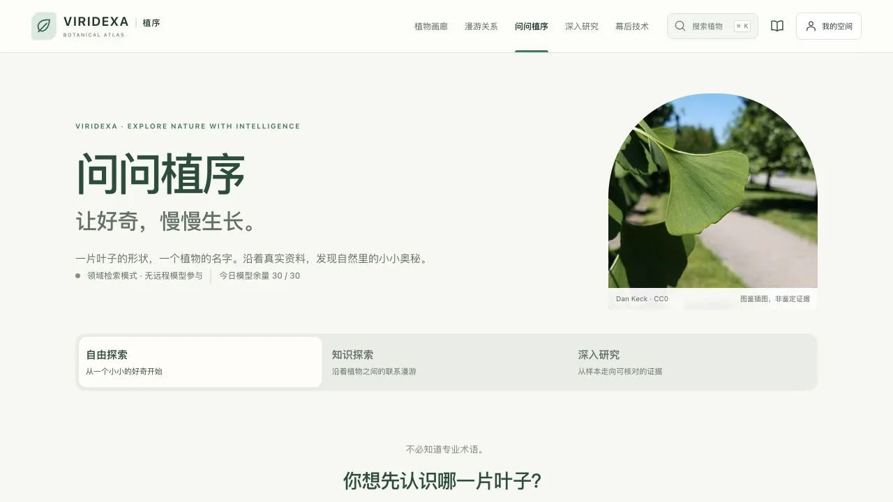
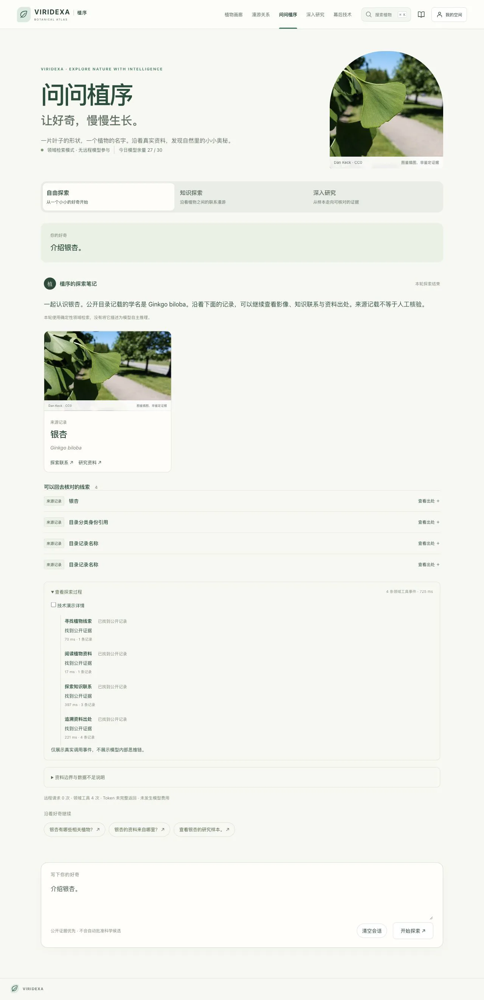

# 问问植序 · Agent 旗舰升级验收

日期：2026-10-28。此次未提交或推送 GitHub，未发布科学事实。工程已实现，最终部署回归仍有环境阻塞，不能宣称全面验收完成。

## 审计与改造

原有六个只读工具、公开证据过滤、Tool Trace、轮询取消、问题/Token 配额和双并发均复用。此前模型为通用兼容适配器，没有免费策略、多轮上下文和植物图文回答。

- `OpenAiModelProvider`：远程端点固定为 OpenRouter；每次调用重新 GET 模型元数据，检查服务端白名单、免费路由/`:free` 身份、全部已报告价格为零、工具支持。不可用时拒绝，不使用旧通用付费端点。
- `OpenRouterPolicy`：prompt/completion/request/image 价格上限为0，禁 provider fallback，要求参数支持，禁插件，不提供供应商侧搜索、生成图片或充值接口。返回模型必须属于此次零价格快照，费用不明确/非零即熔断。
- `OpenRouterBudget`：进程锁+文件锁，持久化、fsync、原子替换；每站每日30次、滚动60秒5次、每用户每日10次模型请求。调用前预占，失败/超时不退款，跨午夜保留记录和分钟窗口。真实请求、模型、Token、费用均留在私有运行目录，用户只存哈希。
- Kill Switch：在 `AGENT_RUNTIME_DIRECTORY` 下创建 `OPENROUTER_DISABLED`，下一次调用立即拒绝。异常费用自动创建并保留熔断；调查后由运维移除文件并重启。`AGENT_MODEL_ENABLED=false` 可关闭模型。不可删除额度账本来恢复额度。
- `AgentService/Controller`：三种体验共用同一执行器，最多3次模型调用/6次工具；简单介绍直接检索。上轮 ID 必须属于当前会话；只继承重新检查公开权限的植物标识和有界历史提示，不无限传递工具结果。清空会话删除服务端上下文；账户切换不能继承运行。重复工具请求复用本轮有界结果，不重复查询。
- `ResearchTools`：对关联植物样本只返回确切关联；可比性调用现有 WorkbenchService，缺少物种、单位、方法不计算差异。扇形叶使用原文 `flabellate` / `fan-shaped` 的精确词面查询，不推断新分类关系。此新增查询仍需生产规模性能复核。
- Vue：自由探索/知识探索/深入研究、真实实体植物卡片、合法媒体组件、来源折叠、后续问题、多轮追问、取消及技术详情。使用真实执行事件轮询渐进更新，没有伪造流式推理或隐藏思维链。模型自由科学叙述仍不直接显示，中文摘要由真实证据生成。
- `/technology` 增加免费策略、探索轨迹、证据约束及可点击问题；实时配置状态和真实联调结果分别呈现。

## 真实 OpenRouter 联调（非 Mock）

Key 仅临时注入隔离后端进程环境，未写入源码、Vue、报告或环境文件。生产配置仍默认关闭远程模型，需要服务器安全环境配置。

共实际预占并发送 **3次**：首次404，无可用约束端点，立即降级；修正不必要的参数后，2次成功响应分别为：

- `nvidia/nemotron-3.5-super-vl:free`
- `dots-studio/dots-3-note-preview:free`

成功响应累计输入3019、输出1539 Token；两次供应商返回费用均为0。首次404未返回用量和费用，不将其伪报为已核实0费用。没有付费模型回退，没有充值请求。

真实工具序列：searchPlants → getPlantProfile → getEvidenceLineage → getResearchSamples。来源调用传入错误标识 `24867` 被拒绝；样本无确切关联，返回证据不足。最终引用 `plant:24867` 可公开读取。本次用时16205 ms，结果为 DEGRADED，不能宣称四工具全部成功。详见 [脱敏真实记录](agent-evidence/real-openrouter.json)。

## 自动测试与浏览器

- Spring：174项通过，0失败/0跳过，包含并发预占、重启、午夜窗口、Kill Switch、费用/定价异常、端点绕过、真实多 tool_call ID、上下文隔离、撤回和卡片身份保护。
- Vue：47项通过；类型检查和生产构建通过。新助手路由约13.5KB（gzip约6.2KB），图表与图谱仍按路由懒加载。没有宣称LCP/INP提升。
- MySQL/REST：本轮前一次完整71/71通过。最终源码再次全量执行时被 Docker 磁盘100%耗尽阻塞，不能将前次结果当作最终通过。
- Python pipeline：18项初跑1项失败（图片采集器 plant_id=0 未提前拒绝），已加入正整数校验，重跑18/18通过。
- Compose：新版镜像已构建，启动因 Docker 内部15GB盘耗尽报 `No space left on device`；为本项目API添加64MB `/tmp` tmpfs。数据库仍需足够持久磁盘，生产搜索/API全量回归未通过。
- 浏览器：隔离技术账户登录→银杏介绍→真实植物卡片→来源追问已实测。桌面截图包含真实4工具轨迹，375px手机连续追问无横向溢出。未声称全部科研/审核界面及所有尺寸完成最终验收。

## 配置与尚未完成

后端使用环境变量 `OPENROUTER_API_KEY`、`OPENROUTER_MODEL=openrouter/free`、`AGENT_MODEL_ENABLED=true`；替代免费模型还必须加入 `OPENROUTER_FREE_MODEL_ALLOWLIST` 并通过每次实时零价检查。不能由前端设置。所有实例必须共享同一持久运行目录以维持全站配额；不能为每个实例另建账本。历史账本增长需运维归档，不得丢弃当前日配额。

1. Docker磁盘扩容或清理须由环境所有者决定；没有删除其他项目镜像、容器、数据库卷，也未执行全局 prune。
2. 隔离测试环境暂保留，待磁盘恢复后完成测试并使用受控cleanup命令清理；不能误操作生产schema。待磁盘恢复后重新执行最终 MySQL、生产API、Compose及全链路回归。没有真实填满30次远程额度；耗尽行为通过隔离确定性测试验证，避免浪费免费调用。
3. 扇形叶数据确有 `flabellate` 原文，但生产规模新查询/图文卡片完整案例尚未验收；不把原有词表未覆盖的值强行标成标准事实。
4. 部分免费模型可能拒绝/误用工具或无法严格给出引用，系统保守降级。未提供任意科学散文生成、无限历史、跨会话持久聊天或新Agent框架。
5. 原始292份科研文件重新计算SHA-256为292/292匹配。本轮无科学审批写入、无具名审核；磁盘恢复后仍需重新核实生产实时统计。
6. Key 曾在聊天中提供，建议用户轮换后再部署；请勿将新 Key 发到聊天、前端或 Git。

官方协议依据：[免费路由](https://openrouter.ai/docs/cookbook/get-started/free-models-router-playground)、[价格上限与路由](https://openrouter.ai/docs/guides/routing/provider-selection#max-price)、[用量与费用](https://openrouter.ai/docs/cookbook/administration/usage-accounting)。保证依赖供应商执行其硬性价格契约；未知状态拒绝请求，不能承诺第三方永无故障或永久免费。
