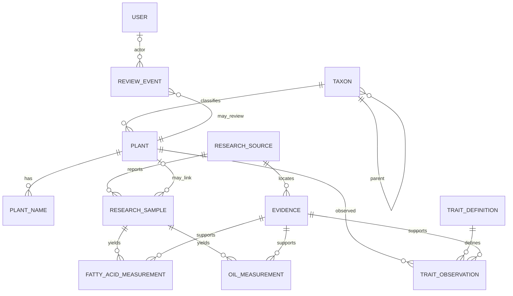

# Database v2 conceptual design

This is a target model, not an executed migration. Phase one reads a verified snapshot of the legacy database with a `SELECT`-only account. No legacy schema was altered. V2 will be provisioned separately with Flyway after the dry-run mapping has been reviewed.

## Core entities

| Entity | Purpose and key fields |
|---|---|
| `taxon` | Stable VIRIDEXA taxon identity, rank, accepted status, parent taxon, canonical scientific name; legacy IDs remain in an external identifier table. |
| `plant` | The research subject and editorial content; links to taxon without collapsing plant identity into a single name string. |
| `plant_name` | Chinese/common/scientific/English names, language, name role, verification state, source and accepted-name relation. |
| `research_source` | Dataset, publication, course document, database snapshot, or other source; records persistent citation, DOI/URL when available, file hash, source date, and license/access note. |
| `evidence` | Exact source locator: page/table/row/crop/bounding box, quote or raw snippet, file hash, and content type. Supports evidence that cannot yet be linked to a plant. |
| `trait_definition` | Controlled trait key, label, domain, unit policy, vocabulary and version. |
| `trait_observation` | Plant/sample trait value, raw text, normalized value, unit, qualifiers, source/evidence, and review state. A missing value remains NULL with an explicit missing reason. |
| `research_sample` | Sample identity, study membership, material/plant part, collection and testing context, and source-specific sample key. An unlinked sample is allowed. |
| `oil_measurement` | Oil result and unit, sample basis, method, moisture basis, raw source value, evidence, and verification state. |
| `fatty_acid_measurement` | One component measurement tied to one sample and one source. Keeps value text, numeric value, unit/denominator, analytical basis, and evidence; values from different studies are never combined into a synthetic profile. |
| `candidate_record` | Unresolved extraction/import item with original payload, candidate type, source locator, proposed association, and pending/rejected/accepted state. Candidates are not formal measurements. |
| `review_event` | Append-only event with entity type/key, event, prior/new status, actor user ID nullable, timestamp, notes, and source reference. Historical NULL actors stay NULL. |
| `user`, `role`, `user_role` | Identity and access roles; password hashes and enabled states are carried only through an explicit account migration plan. |
| `favorite` | User-to-plant relation with uniqueness and timestamps. |
| `media_asset` / `plant_media` | Checksummed path or object reference plus plant relation, alt text, page and crop coordinates; binary files remain in protected storage. |
| `external_identifier` | Source system and accession, including GBIF/WFO identifiers and original matching status. |

## Invariants

1. Plant/taxon identity, study sample identity, and evidence identity are separate keys.
2. Every formal trait or oil/fatty-acid value retains its original source, locator, unit, and raw text.
3. `VERIFIED`, pending, rejected, extracted-only, and unlinked states remain distinguishable; a candidate becomes formal only through an explicit review transition.
4. NULL and missing/unreadable values do not become zero. Numeric domains, denominators, and dry/fresh/mass/volume basis are validated before publication.
5. A fatty-acid component belongs to exactly one research sample and study source. Cross-study comparisons are displayed as comparisons, never copied into a fabricated shared sample.
6. Review history is append-only. Reviewer identity is nullable for historical events and required for new publication actions.
7. Source files are immutable inputs addressed by SHA-256. Derived files record their generating inputs and software version.
8. Relationships shown in the knowledge graph are built from persisted foreign-key relations or documented source links, not model-generated edges.

## Relation outline

Before final DDL, the migration dry run will measure duplicate names, taxon mismatches, unlinked samples/sources, null units/bases, broken image paths, candidate statuses, and review events with null actor IDs. The v2 schema will be adjusted against those findings rather than against historical baseline numbers alone.
