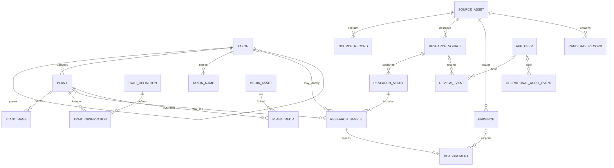

# VIRIDEXA database design

The first executable schema is `apps/api/src/main/resources/db/migration/V1__viridexa_core.sql`. It is a product model for VIRIDEXA, not a clone of a previous application's schema. Flyway creates it in a separate `viridexa` database.

## Model areas

| Area | Tables | Responsibility |
|---|---|---|
| Identity and taxonomy | `plant`, `plant_name`, `taxon`, `taxon_name`, `external_identifier` | Distinguish a research plant record from accepted taxonomic concepts and their source names. Taxon homonyms can coexist. |
| Provenance | `source_asset`, `source_record`, `research_source`, `evidence` | Address every input by SHA-256; retain structured snapshot rows until a domain extractor maps them; preserve page, table, row, image, and bounding-box locators. |
| Traits | `trait_definition`, `trait_observation` | Store controlled definitions separately from the extracted/raw observation, normalized value, unit, state, and evidence. |
| Oil research | `research_study`, `research_sample`, `measurement` | Keep study and sample context. Oil and fatty-acid measurements remain tied to one sample, unit, basis, and evidence. A sample may have no plant/taxon link. |
| Unresolved data | `candidate_record` | Retain raw payloads, unmatched sources, extraction fragments, and rejected/pending items without publishing them as measurements. |
| Media | `media_asset`, `plant_media` | Store an external protected path, checksum, optional relationship, and evidence locator. Binary assets are never stored in Docker volumes or Git. |
| Review and access | `review_event`, `operational_audit_event`, `app_user`, `app_role`, `user_role`, `favorite` | Append scientific review history separately from operational audits; support named future reviewers while preserving nullable historical actor references. |

## Stable identity and re-import behavior

Database primary keys are newly generated by MySQL. Pipeline keys are deterministic checksums over an input asset hash plus a semantic source-row key; they make an import repeatable but do not reuse an old database ID. A `source_record` stores the snapshot row as structured provenance while future extractors validate it. Its original payload and source locator remain attached so that two similar records are not collapsed based on a guessed taxonomic match.

The importer uses insert-only grants and immutable source keys. Corrections create a new review event or a new input version rather than silently replacing a reviewed value. Input files are never written by Flyway or the importer.

## Scientific constraints

1. `plant`, `taxon`, `research_sample`, measurement, and evidence have separate identities.
2. A formal observation or measurement retains raw text, normalized value when justified, unit, analytical basis, source asset, and exact locator.
3. `EXTRACTED`, `REVIEW_PENDING`, `SOURCE_CHECKED`, `APPROVED`, `REJECTED`, `MISSING`, and `UNLINKED` are distinct states; source-image checking does not imply publication approval.
4. NULL stays NULL. Unreadable or absent oil content is not converted to zero.
5. Fatty-acid composition is stored per sample and study. The application can compare studies but does not synthesize a combined profile.
6. `review_event` is append-only by application policy. Historical actor reference and new `actor_user_id` are separate; neither can require a fabricated historical user.
7. Graph edges are projections of actual foreign keys or persisted source relationships.
8. Public reads and agent tools will use approved/released state filters; research-preview data remains visibly labeled.

## Main relationship outline

## Query indexes

V1 uses indexed name prefixes and exact source keys for deterministic API reads. Initial bilingual search uses parameterized `LIKE` over a bounded result set. If the real source volume requires richer morphology search, add a measured MySQL full-text/indexed feature instead of introducing an empty search service. Research measurements are indexed by kind, analyte, state, and sample; taxonomy traversal uses parent/rank indexes.

## Later schema additions

The core model leaves room for: separate unit vocabularies and conversion rules, collection/assay method dictionaries, source license policy, controlled review transitions, normalized graph projections, and privacy retention settings. Add them when imported records show the required values; do not infer units or create placeholder infrastructure.
