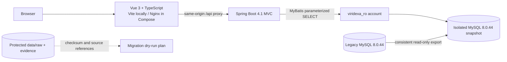

# VIRIDEXA architecture — phase 0/1

## Application boundary

VIRIDEXA is a fresh application in this workspace. The existing `data/` and `database/` trees are protected inputs. The old app source was not present here, so there was nothing to port or clear. The current phase reads a consistent snapshot of the live legacy database through a `SELECT`-only account. The old MySQL service and volume are left in place.

The isolated snapshot uses a dedicated MySQL container on loopback port 3308 with a 1 GiB tmpfs for its data directory. The initial image pull and persistent-directory initialization returned `no space left on device`; Compose now reuses the local MySQL image and bounds restore storage with tmpfs. The measured Docker VM has 8 GiB memory. The isolated data is temporary and re-imported from the same checksum-verified snapshot when the container is recreated. This is not the future v2 target database. Flyway is present in the application dependency set but disabled for this read-only snapshot. A separate v2 schema will be created and migrated only after the dry-run mapping and recovery process are accepted.

For a local hot-reload session, Vite runs on the host at port 5173 and proxies `/api` to the Spring API at port 18080. Compose serves the built `apps/web/dist` through the locally cached Nginx image on port 5173 and proxies `/api` to the API container. The API container uses the locally cached Java 21 image; its jar is built with the Maven Wrapper before `docker compose up`.

## Current request flow

- `apps/web/`: Vue 3, TypeScript, Vite, Vue Router, Pinia, Tailwind CSS; search renders database records returned by the API.
- `apps/api/`: Spring MVC, Spring Security, Bean Validation, Actuator, Springdoc OpenAPI, MyBatis, Flyway, MySQL Connector/J.
- `GET /api/v1/plants`: parameterized search over Chinese name, scientific name, and verified aliases. The query is restricted to public records with `verification_status = 'VERIFIED'`.
- `GET /api/v1/plants/{id}`: returns one verified, public plant or a 404 Problem Detail.
- No write endpoint exists. Anonymous GET is limited to plant reads, health, and API documentation; other requests are denied. CSRF remains enabled. Sessions, form login, and HTTP Basic are disabled. CORS permits only the configured local web origin and GET/OPTIONS.
- The app database pool is read-only. In the compose environment the database account has only `SELECT` grants for the restored legacy schema.
- ECharts and Cytoscape.js are installed for the later research visualization stages; no chart or graph is presented as implemented in phase one. Spring AI is deferred until the controlled research-agent stage.

## Versions and compatibility evidence

Versions were checked on 2026-10-24 before the dependency files were written. The versions in lockfiles/POM are fixed; update them only with a fresh compatibility check.

| Component | Phase-one version | Compatibility evidence / local result |
|---|---:|---|
| Java | 21.0.7 | Installed locally; Spring Boot 4.1.2 supports Java 17–26. |
| Spring Boot | 4.1.2 | Latest stable 4.1 patch checked at implementation time; 4.1.3 was a snapshot. |
| Spring Framework | 7.0.10, Boot-managed | Boot 4.1 system requirements require Spring Framework 7.0.9 or later. |
| Maven Wrapper | 3.10.0 | Generated by Spring Initializr; system Maven 3.6.1 is below Boot's 3.6.3 minimum. |
| MyBatis Spring Boot Starter | 4.1.0 | MyBatis project identifies 4.1.x with MyBatis-Spring 4.1, MyBatis 3.5, Boot 4.1, Java 17+. |
| MySQL | 8.0.44 | Matches the observed source server version; the new service uses a separate tmpfs database directory in phase one. |
| Spring AI | 2.0.2 (deferred) | Spring AI 2.0.x documents support for Boot 4.0.x and 4.1.x; not loaded in phase one. |
| Springdoc OpenAPI | 3.1.1 | Project compatibility guidance lists 3.1.x for Boot 4.1; API docs dependency resolves with the build. |
| Node / npm | 22.20.0 / 11.6.2 | Available locally; Vite 8 and Vue plugin 6 both require Node `^20.19.0 || >=22.12.0`. |
| Vue | 3.5.44 | Compatible with Vue Router 5.4.0 and Pinia 4.1.0 peer ranges. |
| Vite / Vue plugin | 8.3.5 / 6.0.10 | Vue plugin peer range includes Vite 8; local production build passes. |
| TypeScript / vue-tsc | 5.9.3 / 3.3.13 | Type check and production build pass. TypeScript 7.0.2 was rejected because current vue-tsc imports an unexported TypeScript path. |
| Vue Router / Pinia | 5.4.0 / 4.1.0 | Router peer ranges include Vue 3.5 and Pinia 4. |
| Tailwind CSS / Vite plugin | 4.3.3 / 4.3.3 | Plugin peer range includes Vite 8; local production build passes. |
| ECharts / Cytoscape.js | 6.1.0 / 3.34.4 | Installed for later chart and graph views; no empty service is deployed. |

Spring Boot requires Java 17 or later, Spring Framework 7.0.9 or later, and Maven 3.6.3 or later. The locally installed Maven was 3.6.1, so the project uses its wrapper. The initial Maven Central endpoint returned intermittent HTTP 403 responses; dependency verification was retried through Google's read-only mirror of Maven Central. No mirror or credentials are embedded in the project.

## Later stages

- V2 schema migrations use Flyway against a dedicated target database with a write-capable migration identity, never the source snapshot.
- Login and RBAC will be introduced with named users only after user/account migration semantics are mapped. Anonymous reads do not imply permission to review or publish.
- Spring AI will call a remote model behind an optional integration boundary. Search and the verified-data APIs will not depend on model availability.
- Nginx, Ubuntu Compose deployment, resource sizing, and GitHub Actions deployment are later-stage work. No local GPU or large model is assumed.

## Official compatibility references

- [Spring Boot 4.1 system requirements](https://docs.spring.io/spring-boot/system-requirements.html)
- [Spring Boot releases](https://github.com/spring-projects/spring-boot/releases)
- [MyBatis Spring Boot Starter requirements](https://github.com/mybatis/spring-boot-starter)
- [Spring AI getting started and Boot compatibility](https://docs.spring.io/spring-ai/reference/getting-started.html)
- [Springdoc compatibility FAQ](https://springdoc.org/index.html#faq)
- [Vue releases](https://vuejs.org/about/releases)
- [Vite guide / Node requirement](https://vite.dev/guide/)
