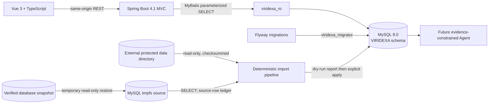

# VIRIDEXA architecture

VIRIDEXA is implemented from its own product requirements. The PlantScope application, pages, APIs, schema, and CSS are not runtime dependencies or code templates. Scientific files and the database snapshot are treated as immutable inputs to a separate import pipeline.

## Runtime and ingestion boundaries

Research inputs are managed inside this project at `data/` (`VIRIDEXA_DATA_DIR=./data`). Original archives remain read-only inputs; extracted results, image mappings and derived outputs retain their existing categories. Historical SQL archives are stored in `data/backups/legacy-database/` and must never be executed as current Flyway migrations. Compose mounts only `./data` read-only at `/science-inputs/data`, retaining the stored `data/...` source locators without mounting the repository or its secrets. Original documents remain subject to existing authorization and licensing controls. The external sibling backup is retained until a human decides it is no longer needed. The entire data tree is ignored by Git; ignored files are NOT protected from `git clean`, which must not be used on this tree.

The v1 database is created by Flyway on the new MySQL service. The API uses a `SELECT`-only database user. A separate migrator user applies schema migrations, and a separate insert-only importer user writes the output of explicit pipeline runs. No API connection points to a historical schema or snapshot.

## Implemented vertical slice

- `apps/web/`: Vue 3, TypeScript, Vite, Vue Router, Pinia, Tailwind CSS; the plant research page calls the new REST API.
- `apps/api/`: Spring MVC, Spring Security, Bean Validation, Actuator, Springdoc OpenAPI, MyBatis, Flyway, MySQL Connector/J.
- `GET /api/v1/plants`: searches VIRIDEXA `plant`, `plant_name`, and `taxon` records in `PUBLIC` or clearly marked `RESEARCH_PREVIEW` state.
- `GET /api/v1/plants/{id}`: returns one VIRIDEXA plant record and its source/status fields.
- `scripts/pipeline/import_course_extracts.py`: verifies the protected course PDF hash, indexes input assets, and stages the extracted course-plant and oil-sample slice. Dry-run is the default. Explicit `--apply` writes only to the local VIRIDEXA Compose database.
- `scripts/pipeline/import_snapshot_records.py`: restores the archived snapshot into a temporary isolated MySQL instance, reads selected scientific/review tables, and stores raw source rows plus review/audit events in VIRIDEXA provenance tables. It does not connect to the former live service.
- Source names and field-level evidence states remain separate from overall plant review state. Extracted records are not silently promoted to approved records.

Anonymous requests are limited to read endpoints, health checks, and API documentation. Other methods are denied. CSRF remains enabled; form login and HTTP Basic are disabled. CORS permits the configured web origin and GET/OPTIONS. The API account cannot modify scientific data.

## Data model and scientific invariants

The new schema is defined in `apps/api/src/main/resources/db/migration/V1__viridexa_core.sql`. It separates plant records, taxonomy, source assets, evidence locators, trait observations, studies, samples, measurements, import candidates, media, external identifiers, users/roles, favorites, and append-only review events.

- New table identities are generated by VIRIDEXA. Historical numeric IDs are not required or reused.
- A sample may remain unlinked from a plant or taxon while preserving its source record and evidence.
- A measurement belongs to one sample and has one unit, analytical basis, status, and evidence locator. Study values are never merged into a synthetic sample.
- Missing and unreadable values use NULL plus an explicit state; they do not become zero.
- Historical review actor references may be null. New publication requires a named reviewer.
- The knowledge graph is a projection of persisted relationships; model output cannot create graph edges.
- Search and ordinary plant reads never depend on model availability.

## Versions and local compatibility evidence

Dependency versions remain pinned in `pom.xml` and `package-lock.json`. The baseline compatibility check on 2026-10-24 confirmed Java 21 with Spring Boot 4.1.2, MyBatis Starter 4.1.0, and MySQL 8.0.44; Vue 3.5.44, Vite 8.3.5, TypeScript 5.9.3, Router 5.4.0, Pinia 4.1.0, Tailwind 4.3.3, ECharts 6.1.0, and Cytoscape 3.34.4. Spring AI 2.0.2 was reviewed for Boot 4.1 compatibility but remains deferred until the evidence-constrained agent stage. The new Compose target is pinned to MySQL 8.0.44.

The API requires Java 21 and is built with the Maven Wrapper. The Vue build requires Node 22.12 or later; `.nvmrc` pins the validated Node 22.20.0 local toolchain.

## Next architecture increments

1. Extend the independent pipeline to normalize snapshot source rows, then extract WFO, NHM, Flora of China, Global Spectrum, GBIF, literature, and USDA data.
2. Add evidence-backed trait and oil/fatty-acid query endpoints, sample comparisons with units/basis, and public evidence coverage.
3. Add authentication, named reviewer RBAC, and append-only review actions.
4. Add graph projections and a remote Spring AI agent with read-only tools over approved records.
5. Complete browser E2E, resource sizing, and Ubuntu deployment after the application flows stabilize.

## Compatibility references checked for the pinned baseline

- [Spring Boot system requirements](https://docs.spring.io/spring-boot/system-requirements.html)
- [Spring Boot releases](https://github.com/spring-projects/spring-boot/releases)
- [MyBatis Spring Boot Starter requirements](https://github.com/mybatis/spring-boot-starter)
- [Spring AI getting started and Boot compatibility](https://docs.spring.io/spring-ai/reference/getting-started.html)
- [Springdoc compatibility FAQ](https://springdoc.org/index.html#faq)
- [Vue releases](https://vuejs.org/about/releases)
- [Vite guide and Node requirement](https://vite.dev/guide/)
